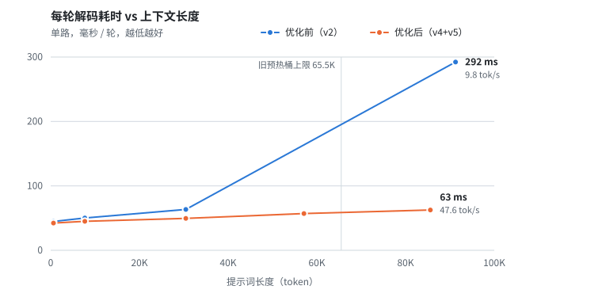

<div align="center">

# Gaudi2 Single-Card vLLM

**用一张 Intel Gaudi2，把 27B 的大模型跑到能日常使用**


[项目是什么](#项目是什么) · [现在能做到什么](#现在能做到什么) · [一路做了哪些优化](#一路做了哪些优化) · [没走通的路](#没走通的路) · [怎么用](#怎么用) · [局限](#局限)

</div>

---

## 项目是什么

Intel Gaudi2 是一张有 96 GiB 显存的 AI 加速卡，官方的用法是八卡服务器。这个项目做的是另一件事：**只用一张卡，装在一台老 Xeon 平台上，跑一个 27B 参数的混合架构大模型，并且把它调到够快、够稳、上下文够长。**

具体来说，是在 [vLLM](https://github.com/vllm-project/vllm) 和它的 Gaudi 插件之上，围绕下面这套组合做适配和优化：

- **模型**：Qwen3.5 架构的 27B 模型，FP8 量化。它的 64 层里有 48 层是 Gated DeltaNet（一种带递归状态的线性注意力），16 层是普通的全注意力。
- **投机解码**：用一个小的草稿模型（DFlash2）或模型自带的预测头（MTP）一次猜 7 个 token，再由主模型一次验证，猜对几个就前进几步。
- **真实采样**：全程保留 temperature / top-p / top-k 的随机采样，不为了速度退化成 greedy。
- **长上下文**：最长 262K token。

仓库里是从服务器上直接导出的完整源码，加上这一路的优化说明、离线测试和测速工具。

> [!NOTE]
> 这不是 Intel 或 vLLM 的官方发行版，也不是一键安装包。它是一台真实机器上的工程记录：哪些改动有效、哪些没用、数字是怎么测出来的，都如实写在这里。

## 现在能做到什么

单卡、非 greedy 采样、关闭 thinking 的实测结果：

| 场景 | 速度 |
|---|---:|
| 单路对话，短上下文 | **67–75 tok/s** |
| 单路写代码 | **112–134 tok/s** |
| 两路同时写代码，合计 | **约 209 tok/s** |
| 单路，3 万 token 上下文 | **59–65 tok/s** |
| 单路，8.6 万 token 上下文 | **47.6 tok/s** |
| 最长上下文 | **262K**（25.6 万的速度是推算的，约 30 tok/s，没有实测） |

写代码比聊天快，是因为草稿模型对代码猜得更准，每轮能多前进几个 token。

<picture>
  <source media="(prefers-color-scheme: dark)" srcset="docs/assets/decode-round-dark.svg">
  
</picture>

<sub>上图是最近一轮优化的效果：上下文越长，优化前越慢，到 9 万 token 时每轮要 292 毫秒；现在基本是一条平缓的直线。圆点是实测值，优化前在 3 万到 9 万之间没有测量点，连线只是示意。</sub>

## 一路做了哪些优化

从「卡都认不出来」到上面这些数字，大致经历了十一个阶段。每个阶段的测法不一样（提示词、输出长度、是否 greedy 都变过），所以**数字只能在同一阶段内前后比较**，不能跨阶段相除。

### 第 0 步：让卡工作起来

这张卡是通过转接卡装在一台老平台上的（Xeon E5-2696 v3，PCIe 只有 Gen3 x8）。一开始系统根本识别不到它，识别到之后升级驱动又反复内核崩溃。

最终查明崩溃的根因是驱动里一处把设备地址当物理地址用的错误，只在 IOMMU 做地址转换时才触发；加一个内核启动参数让两种地址一致后，问题消失。再加上三处让驱动接受这套非标准硬件组合的小补丁，卡才算稳定可用。

这部分属于驱动和硬件层，不在本仓库里，这里只作为背景交代。

### 第 1 步：让模型装得下、算得对

第一次带草稿模型启动时直接显存不足。原因是插件给每一个「逻辑上的」注意力层都分配了一整份缓存，21 个逻辑层算下来要 **116.6 GiB**，而实际上它们可以共用 5 份物理存储。改成共用后，缓存总量降到约 **47.8 GiB**，模型能装下了。

共用之后又暴露出第二个问题：4 组注意力层本该各用各的缓存地址，代码却让它们全都用了第一组的地址，16 个注意力层里有 12 个的历史被后面的层覆盖。表现是模型会输出一长串「0」。修正地址路由后，同一个测试里最长的连续「0」从 **893 个降到 2 个**。

### 第 2 步：发现原生算子库从来没加载成功过

排查速度时发现，项目自带的一整套 Gaudi 专用算子（C++ 和设备内核）其实一次都没有生效过。构建脚本链接了错误的插件变体，加载时静默失败，所有计算一直在走通用的 PyTorch 实现。

改一行构建配置、重新编译之后，所有专用内核同时生效：

| 单路，142 token 输入 | 修复前 | 修复后 |
|---|---:|---:|
| 解码速度 | 23.2 tok/s | **44.6 tok/s**（+92%） |
| 提示词处理速度（1115 token 输入） | 2,662 tok/s | **3,486 tok/s**（+31%） |

### 第 3 步：调对「分桶」

Gaudi 上每种输入形状都要提前编译，一种形状叫一个桶。原配置只有「4 路并发」这一种批大小，单个请求会被补齐成 4 路，专门为单路写的快速内核永远用不上。

补上单路的桶之后，快速内核才开始触发。同时摸清了一条规律：编译图占的显存取决于最大的那个桶有多大，而不是桶的数量。最后定下 63 个桶、占 12.76 GiB 的配置。

### 第 4 步：接入 MTP，并第一次有了干净的对照

这一步做了两件事。

一是修掉了一个让插件**无法关闭投机解码**的缺陷（一处空值检查自己会报错）。修好之后才第一次测到「不开投机」的基线，之前所有的加速比其实都没有参照。

二是把模型自带的预测头（MTP）接了进来，它不需要单独的草稿模型。当时（greedy、每次输出 128 token）三种方式的对比是：

| 方式 | 相对不开投机 |
|---|---|
| MTP | **1.65 倍** |
| DFlash2 | 1.14 倍 |

8 路并发时 MTP 的总吞吐约 **198 tok/s**。这一轮还有一个意外发现：处理长提示词时，不开投机反而最快。

### 第 5 步：在真实随机采样下跑通 7 个草稿 token

前面的对比用的是 greedy。真正使用时要随机采样，验证草稿就不能简单比较「是不是同一个词」，而要按概率接受或拒绝，被拒绝的位置还要重新抽一个词。这条路径是重新移植和接通的。

第一版能跑但不快（短故事提示词，约 12.7 tok/s）。之后一项项改：

- 修掉一处由日志语句引起的编译中断，和一处采样器没有接到正确路径上的遗漏。
- 拒绝后重新抽词的计算，从「每个草稿位置都算一遍整个词表」缩到「只算第一个被拒绝的位置」。
- 草稿每一步的几个小操作合并成一个编译区域；传给设备的零散数据从 36 次合并到 7 次。
- 主模型按 4 层一组编译，减少主机提交的次数。
- 重新抽词这一步写了专用的设备内核。

同一个 128 token 的短请求，从约 **17.1 tok/s 提到 28.1 tok/s**。这是单次测量，两次输出的文本也不同，只能说明方向，不能当成精确的提升幅度。专用内核那一项单独看快了很多，但没有换来整体速度的变化。

### 第 6 步：两个不是代码的问题

这一阶段速度一度莫名其妙地崩掉，最后查出来都不是算法问题：

- **诊断配置忘了关。** 一份 profiler 配置留在环境里，让一个本该 6 秒的请求跑了 **414 秒**。移除后恢复正常。
- **主机内存不够。** 这台机器只有 32 GiB 内存，还同时跑着两个虚拟机。当内存占用超过 90% 时，Gaudi 的运行时会不停淘汰已编译的缓存，然后又重新编译，每轮解码拖到几秒钟。释放掉一批没在用的大页内存、把其中一个虚拟机缩到 4 GiB 之后，缓存才留得住，同一个请求稳定回到 **3.85 秒（约 33 tok/s）**。

教训是：在这种小内存主机上，先确认缓存没有被淘汰，再谈优化算子。

### 第 7 步：回到 DFlash2，按草稿模型的需要重新分组

草稿模型（DFlash2）需要主模型中间 5 个位置的输出。原来的做法是 64 层一层层提交，每层之间都有主机开销。新做法按这 5 个位置把 64 层切成 19 组，每组编译成一个整体，每一层仍然完整执行，没有跳层。

| 128 token 短请求（含首 token 时间） | 之前 | 之后 |
|---|---:|---:|
| 总耗时 | 6.91 秒 | **4.16 秒** |

之后又优化了主机和设备之间交接数据的几个小环节，同条件对照只快了约 1%，在波动范围内，不算有效。

### 第 8 步：发现一直在用最坏的提示词测速，并重新定位瓶颈

到这里才发现，之前一直用来测速的那个「月球故事」提示词，草稿的接受率只有 7%–12%，几乎是最坏情况。换成代码和技术类的提示词，单路是 **80–135 tok/s**。测速的提示词选错，是之前觉得「优化效果不明显」的主要原因。

然后用官方的 profiler 加设备级 trace，第一次看清了一轮解码的时间去向：

- 一轮约 42 毫秒，其中设备真正在算的是 28 毫秒。
- 这 28 毫秒里有 15 毫秒是把全部模型权重读一遍，**已经顶到了显存带宽**，不换硬件就降不下去。
- 剩下能动的只有两块：随上下文变长而增加的缓存读取，和设备等主机的那十来毫秒。

这也推翻了更早的一个判断（「设备只忙 12 毫秒，主要在等 CPU」）。

### 第 9 步：两路并发提速

实际使用最多两路并发，于是集中优化这个场景：

- 把原来只支持单路的 GDN 快速内核扩展到两路。
- 并发上限从 4 降到 2，少编译一批用不上的形状。
- 每轮开始前主机要准备一批索引和页表，原来是 Python 循环，改成向量化计算。上线时先让新旧两种算法同时跑、逐轮比对，全部一致后才切换到新算法，出现任何不一致就自动退回旧算法。

| 两路并发 | 之前 | 之后 |
|---|---:|---:|
| 每轮耗时 | 约 64 毫秒 | **约 52 毫秒** |
| 写代码，两路合计 | 141–173 tok/s | **约 209 tok/s** |

### 第 10 步：长上下文提速，并支持到 262K

这是最近效果最明显的一步。

上下文一长，解码就明显变慢。查下来的原因是：每轮要验证 8 个 token，旧实现把它们当成 8 个互不相干的请求，**每个都把整段历史缓存从显存里完整读一遍**。3 万 token 的上下文，每轮要读 16 GiB，而去重后其实只需要 1.9 GiB。另外，超过 6.5 万 token 之后还会掉进一条没有预编译的慢路径。

改成 8 个 token 共用同一份历史缓存、只读一遍之后：

| 上下文长度 | 之前 | 之后 |
|---|---:|---:|
| 3 万 token | 45.2 tok/s | **59–65 tok/s** |
| 约 9 万 token | 9.8 tok/s | **47.6 tok/s** |
| 预编译覆盖的最长上下文 | 6.5 万 | **26.2 万** |

### 第 11 步：清理编译中断

用日志定位并修掉了两处「编译中断」（本该编译成一整块的代码被切成了碎片）：一处在候选词选择，一处只在两路并发时出现在草稿模型里。另外让 4 组注意力层共用同一份掩码，少提交一批零散操作。

如实说：这三项**修复都生效了，但速度没有变化**。它们的价值是让执行路径更干净，而不是更快。

## 没走通的路

同样值得记下来，免得别人再走一遍：

| 尝试 | 结果 |
|---|---|
| 把主模型的执行「预录」下来重放 | 结果完全正确，提交时间少了 6.7%，但整组完成时间反而多了 3.3%，没有上线 |
| 削减编译缓存的检查项（guard） | 试了两种范围，都没有可测的变化 |
| 草稿模型改用静态编译 | 启动就失败 |
| 5 个草稿 token 加专用内核 | 唯一一次实测只有 5.4 tok/s（有形状没预热到），没有继续追，退回 7 个 |
| 换一种 top-k / top-p 筛选算法 | 单独计时反而从 2.6 毫秒变成 15.4 毫秒，关闭 |
| 采样参数复用、交接数据合并、预测头合并成大编译区域 | 三项单独或一起开，都没有胜过原路径 |
| 主模型层组再合并、异步准备下一轮 | 主模型的设备时间已到带宽下限，主机侧不在关键路径上，放弃 |

一个反复出现的规律：**主机侧省下的时间，不一定能变成整体速度**。只有落在关键路径上的才算数，而这一点只有采了设备级的 trace 才看得出来。

## 怎么用

```text
vllm-core/            vLLM 主程序源码（含服务器上的本地改动）
vllm-gaudi/           Gaudi 插件、专用算子、设备内核
native/mtp-sampling/  随机采样纠正的设备内核扩展
validation/           不需要 Gaudi 设备就能跑的 2504 项测试
tools/                测速脚本和 trace 分析脚本
examples/             实测所用配置的启动脚本示例
docs/                 详细的优化说明和快照说明
```

- **想了解技术细节**：看 [优化说明与实测](docs/OPTIMIZATION.md)，里面有每一项改动的原理、开关和完整数据。
- **想跑测试**：`python -m pytest -q validation`，只需要 torch、numpy 和 pytest，详见 [离线验证](validation/README.md)。
- **想复现配置**：参考 [启动脚本示例](examples/launcher-v5.example.sh)，路径需要换成自己的。专用算子和设备内核要按自己的 SDK 重新编译，仓库不带编译产物。
- **想自己测速或采 trace**：看 [工具说明](tools/README.md)，里面写了几个容易踩的坑。

这是一份多组件的源码快照，仓库根目录不能直接当成一个 Python 包安装。使用前请准备好版本匹配的 Gaudi 软件栈，不要为了它去刷固件或替换驱动。

<details>
<summary>快照对应的软件版本</summary>

| 组件 | 版本 |
|---|---|
| 硬件 | Intel Gaudi2，单卡 |
| Python | 3.12 |
| Gaudi 驱动 | `1.24.1-b336d5e` |
| Habana Torch plugin | `1.24.1.482` |
| PyTorch | `2.11.0a0+git009b5f6` |
| vLLM | `0.28.1rc1.dev100+gfe755c889.d20261009.empty` |
| vLLM 核心 Git 基线 | `fe755c88995ad468882517b6c4bdd60138d46a3a` |
| Gaudi 插件 Git 基线 | `57a50be3f7fc3a61c0a89c9ae3a3612072269b99` |

Git 基线不包含全部本地改动，请以仓库文件和 `SOURCE_SNAPSHOT.json` 里的逐文件哈希为准。导出方式见 [快照说明](docs/SNAPSHOT.md)。

</details>

## 局限

- **所有数字都来自同一台机器、同一个模型**，换硬件、换模型、换提示词都会不一样。多数测量只跑了少数几次。
- **25.6 万 token 的速度没有实测**，只是按规律外推。
- **长提示词的首 token 时间还比较长**：8.6 万 token 约 32 秒，这部分还没有优化过。
- 最近几项改动的正确性验证包括：2504 项离线测试、两路并发下新旧实现的输出逐字相同、长上下文输出抽查。但单路在 temperature=0 时输出本身不能逐字复现，原因还没查清；工具调用、中途取消等场景也没有在最新配置下重新验收。
- 只测过一到两路并发。
- 没有宣称达到了硬件的性能上限，也不保证投机解码在任何负载下都比不开更快。

## 来源与许可

本项目基于 1Cat-vLLM-Gaudi 工程分支、[vllm-project/vllm-gaudi](https://github.com/vllm-project/vllm-gaudi) 和 [vllm-project/vllm](https://github.com/vllm-project/vllm)。其中 FP8 矩阵乘、基础的归一化和位置编码、以及一部分 GDN 内核来自原有实现，本项目做的是适配、接线和在此之上的优化，不把上游已有的能力算作自己的。

这是一次源码发布，不是向上游提交的 PR。部分适配、测试和文档使用了 AI 辅助，仍需要人工审查和在目标环境里验收。

主体采用 Apache-2.0，见 [vLLM LICENSE](vllm-core/LICENSE) 与 [Gaudi 插件 LICENSE](vllm-gaudi/LICENSE)；第三方目录和文件保留各自的许可。仓库不包含模型权重、编译产物、运行日志、trace、机器凭据和私有环境文件。
