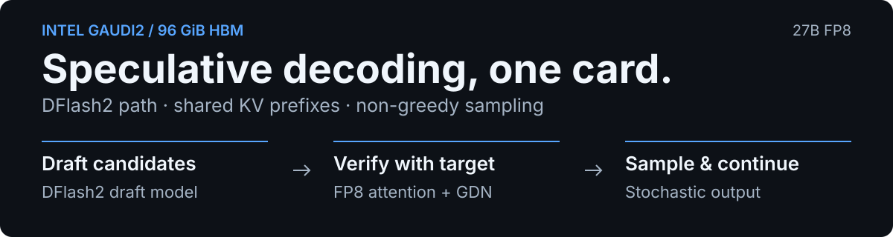
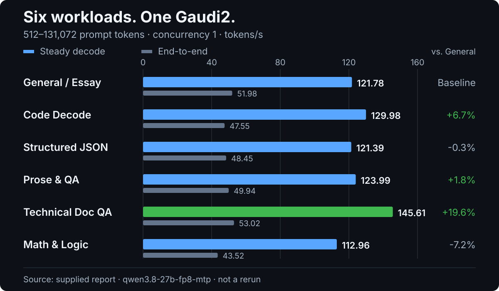

<div align="center">

# Gaudi2 Single-Card vLLM

**Qwen3.8-27B FP8 + DFlash2 FP16 on one Intel Gaudi2, plus image and video generation through vLLM-Omni.**

[](#quick-start)
[](#requirements)
[](LICENSE)

[Benchmarks](#benchmarks) · [Image & video](#image-and-video-generation-vllm-omni) · [Quick start](#quick-start) · [API](#api) · [Documentation](#documentation) · [Limitations](#limitations)

</div>

<p align="center">
  
</p>

A source snapshot combining vLLM, the Gaudi hardware plugin, and native kernels to run a **Qwen3.8-27B FP8 target model + DFlash2 FP16 draft model** on a single **96 GiB Gaudi2**. It includes non-greedy speculative decoding, installation and serving scripts, CPU-side validation, and performance tools.

**The target checkpoint does not need to include MTP layers for this DFlash2 setup.** DFlash2 uses a separate FP16 draft model. The existing service alias `qwen3.8-27b-fp8-mtp` is retained in the examples and benchmark records; its `-mtp` suffix does not imply that MTP layers are required.

This is a community engineering snapshot, independent of Intel and the official vLLM releases.

## Benchmarks

### Six workloads, nine prompt lengths

Measured on **2026-11-07** against the v19 deployment (commit `8f3d92e`: 2048-token prefill chunks, sliced prefill attention from 16K, fused GDN RMSNorm, BF16 GDN prefill) with the user's LLM speed-test harness: **6 workloads × 9 prompt lengths**, from **512 to 131,072 tokens**, through the OpenAI-compatible endpoint serving `qwen3.8-27b-fp8-mtp`. All **54 measurements** show **1/1 requests successful** at concurrency **1**.

<p align="center">
  
</p>

| Workload | Steady decode (tokens/s) | vs. General | End-to-end (tokens/s) | Reported TTFT* (ms) |
|:---|---:|---:|---:|---:|
| General / Essay | 116.50 | Baseline | 56.51 | 7,058.4 |
| Code Decode | 131.45 | +12.8% | 57.28 | 7,113.0 |
| Structured JSON | 124.79 | +7.1% | 55.56 | 7,122.8 |
| Prose & QA | 114.05 | −2.1% | 51.50 | 8,196.0 |
| **Technical Doc QA** | **136.42** | **+17.1%** | 55.48 | 7,973.6 |
| Math & Logic | 125.21 | +7.5% | **57.01** | 7,155.5 |

Prefill peaks at **5,814.88 tokens/s** (8,192-token prompt, Technical Doc QA) and is **4,944–5,815 tokens/s** from 4K to 32K prompt tokens in every workload; at 131,072 tokens it is **3,437–3,598 tokens/s** (TTFT 36.4–42.5 s). Compared with the [previous report](docs/benchmarks/previous/source-report.png), the mean TTFT across the nine lengths drops by **14.5–15.4%** in every workload and the 131K prefill rises from 3,015–3,159 to 3,437–3,598 tokens/s, while the mean inter-token latency stays at about 27–29 ms.

*Source: the [report screenshot](docs/benchmarks/source-report.png), transcribed. The summary labels TTFT as “P50,” but each figure is within about 3 ms of the mean of its nine prompt-length rows; treat them as reported aggregates, not verified request-level percentiles. Decode rates vary from row to row with the draft acceptance of each prompt. “Structured JSON” is the report's workload label; it does not establish constrained-decoding support.*

→ **[Full results, context-length curves, and metric notes](docs/BENCHMARKS.md)** · [54-row data](docs/benchmarks/workload-details.csv) · [Summary data](docs/benchmarks/workload-summary.csv)

<details>
<summary><strong>Earlier engineering measurements — different test protocol</strong></summary>

The original repository reports the following on one Gaudi2 with a 27B FP8 target and DFlash2 draft model. These runs use `temperature=1.0`, `top_p=0.95`, `top_k=20`, thinking disabled, and 512 output tokens. Short-prompt results are medians of three runs from v14; long-context decode is from v17 and TTFT from v16. They are separate from the supplied six-workload report above.

| Scenario | Streaming decode | TTFT |
|:---|---:|---:|
| General explanations and essays, one stream | 80–116 tokens/s | — |
| Python / Go / TypeScript, one stream | 164–196 tokens/s | — |
| JSON extraction and long repetition, one stream | 273–294 tokens/s | — |
| Chinese prose, one stream | 53 tokens/s | — |
| Code and reasoning, two concurrent streams combined | 243–312 tokens/s | — |
| ~55K-token context, one stream | 96 tokens/s | 14.2 s |
| ~95K-token context, one stream | 85 tokens/s | 26.7 s |
| ~180K-token context, one stream | 82 tokens/s | 59.7 s |
| Prefix-cache hit at ~57K / ~95K tokens | — | 0.9 s |

The configured per-request context limit is **262,144 tokens**, including prompt and output. This is a configuration limit, not a fully validated benchmark claim. See the [optimization log](docs/OPTIMIZATION.md) for version-specific measurements and conditions.

</details>

### Image and video generation (vLLM-Omni)

The same card also serves two diffusion models through vLLM-Omni. They run on this repository's Gaudi plugin (`vllm-gaudi/vllm_gaudi/omni`), one model at a time, never alongside the 27B service. Measured on **2026-11-07**. Steady-state figures are second or later requests; the first request after startup also compiles.

| Model | Task | Before | Now | Change |
|:---|:---|---:|---:|---:|
| **MiniMax H3** (FL2VA, LightX2V 4-step Turbo LoRA, online FP8) | 5 s text-to-video + audio, 1344×768, 124 frames | 191.5 s | **100.6 s** | **−47%** |
| **MiniMax H3**, experimental [direct MME/TPC attention](native/mme-direct-attention)† | same request | 191.5 s | **79.7 s** | **−58%** |
| **Qwen-Image 2.1** (BF16) | Text-to-image 1024², HTTP request | 6.5–7.5 s | **4.4 s** | ≈ −35% |

† Measured 2026-11-09. Opt-in only: hand-programmed MME/TPC attention in 47 of 50 DiT layers, pinned text-encoder offload, and a resident DiT for t2va (VAE tile batch 4). The default launcher still gives 100.6 s. Sampled per-layer attention error against FP32 is below 1% RMS. The video still differs from production by about 18 dB PSNR, the same gap as between production and plain FusedSDPA, so this is not a production-qualified replacement. See [§23.10](docs/OPTIMIZATION.md#2310-直接编程-mmetpc-注意力实验路径).

<details>
<summary><strong>Where the time goes and what changed</strong></summary>

**MiniMax H3**, one 5-second video:

| Stage | Before | Now | Experimental† |
|:---|---:|---:|---:|
| DiT forward ×4 | 42.36 s each | **20.09 s each** | **16.04 s each** |
| Video VAE decode | 14.4 s | 11.3 s | 11.7 s |
| Text encoding | 3.8 s | 3.9 s | 3.1 s |
| **Request** | **191.5 s** | **100.6 s** (first request 166 s) | **79.7 s** |

Each step below was added cumulatively and measured on the same 5-second request:

| Change | Request |
|:---|---:|
| Original | 191.5 s |
| Unaligned keys split into a 128-aligned head and a short tail, merged exactly | 158.4 s |
| `PT_HPU_SDPA_HEAD_FACTOR=2` (bit-identical output) | 154.3 s |
| Fast softmax | ≈ 131 s |
| Regional `torch.compile` of the DiT blocks (HPU backend) | 116 s |
| Row-max-free softmax: q/k are RMS-normalised, so the Cauchy–Schwarz bound replaces the row max; one compiled graph per 2,560-query chunk | 103.2 s |
| VAE attention with fast softmax and aligned keys | **100.6 s** |
| *Experimental:* hand-programmed MME/TPC attention, opt-in (same-day re-measured baseline 100.45 s) | 84.4 s |
| *Experimental:* plus pinned text-encoder offload and resident DiT (t2va, VAE tile 4) | **79.7 s** |

Attention is now about 300–315 ms per layer. Its two matrix products need only about 180 ms on the MME. The rest is the score matrix making four trips through HBM, about 640 GB per layer at roughly 2 TB/s. Tile shapes where the graph compiler keeps the score tile in SRAM do not help: there the TPC exponential becomes an equally high limit (282 ms for QK^T → exp → row sum). Block-sparse attention, K/V pooling, FP8 attention products, polynomial and bit-trick exponentials, graph-compiler slicing knobs, two-graph splits, and other tilings were measured and rejected. Details: [optimization log §23](docs/OPTIMIZATION.md#23-vllm-omni-媒体模型minimax-h3-的-dit-注意力).

**Experimental: hand-programmed MME/TPC attention (2026-11-09).** [`native/mme-direct-attention`](native/mme-direct-attention) submits Gaudi2 MME descriptors and custom TPC exp kernels directly through a private SCAL stream. It replaces the DiT attention in 47 of 50 layers (233.7 ms per layer instead of 323 ms). It is enabled only by an opt-in overlay in an isolated container, not by the default launcher. The same request takes **84.4 s**. With two launcher options added, the pinned text-encoder offload and a resident DiT (t2va only, VAE tile batch 4), it takes **79.7 s**. Sampled per-layer error against FP32 stays below 1% RMS. The video still differs from production by about 18 dB PSNR, the same gap as between production and plain FusedSDPA, so this is not a production-qualified replacement. Measurements also show the limits of the stack: QK is bound by each MME's output side (about 0.82 TB/s per MME, the same as the stock compiler), PV is bound by input reads (about 210 TFLOPS), and QK and PV do not overlap on one engine. Details: [optimization log §23.10](docs/OPTIMIZATION.md#2310-直接编程-mmetpc-注意力实验路径).

**Qwen-Image 2.1**: 3.59 s server-side at 1024² (3 DiT steps of about 0.32 s each once warm), 17.0 s at 1536², 41.6 s at 2048², about 7.0 s for an image edit. The changes are:
- Text tokens padded to 64-token buckets, so compiled graphs are reused across prompts; padded rows are skipped on the RoPE frame axis.
- Boolean attention masks sent as additive 0/−inf bias, which avoids a slow FusedSDPA path.
- Regional compile of the DiT blocks.
- Automatic VAE tiling only above 1536² pixels.
- Warm-up requests at startup.

Online FP8 was 11% faster at 1024² but changed image composition (17–26 dB PSNR against BF16) and is not enabled. Details: [optimization log §24](docs/OPTIMIZATION.md#24-vllm-omni-媒体模型qwen-image-21).

</details>

The Omni switches are environment variables and default to off: `VLLM_GAUDI_OMNI_HPU_COMPILE`, `VLLM_GAUDI_OMNI_SDPA_SOFTMAX_MODE`, `VLLM_GAUDI_OMNI_SDPA_KV_ALIGN`, `VLLM_GAUDI_OMNI_SDPA_MAXFREE` (+ `_SKIP_LAYERS`), `VLLM_GAUDI_H3_VAE_SOFTMAX_MODE` and `VLLM_GAUDI_H3_VAE_KV_ALIGN`. The one exception is `VLLM_GAUDI_OMNI_SDPA_KV_ALIGN`, which is on by default (128). The H3 deployment uses `SOFTMAX_MODE=fast`, `PT_HPU_SDPA_HEAD_FACTOR=2`, `HPU_COMPILE=1`, `MAXFREE=1` with layers `45,48,49` skipped, and the VAE in fast mode with alignment 128. The model launchers and the Qwen-Image worker are not part of this repository.

## What is optimized

- **Stochastic speculative decoding.** A separate DFlash2 FP16 draft model proposes candidates for the Qwen3.8-27B FP8 target, retaining temperature, top-p, and top-k sampling. Target-side MTP layers are optional. Gains depend on draft acceptance and workload content.
- **Long-context attention.** Verification tokens share a historical KV prefix; dense attention reads the context together. A contiguous KV mirror avoids gathering the entire cache every decode round for a single long request.
- **Prefill and prefix reuse.** Chunked prefill uses finer context buckets and batched attention slices. Prefix caching combines vLLM attention KV reuse with device-side GDN state snapshots.
- **Host/device overlap.** Lookahead submission, device-side draft preparation, vectorized indices, and compiled regions reduce host preparation and submission gaps.
- **Native kernels and FP8.** Fused GDN recurrence, specialized rejection sampling, faster candidate selection, FP8 vocabulary projection, and FP8 KV storage target device time and memory use.
- **Image input and recipe caching.** Fixed vision buckets compile during warm-up. A TPC kernel-library shim enables device recipe caching across the native libraries.
- **Diffusion models (vLLM-Omni).** DiT attention with aligned key splitting and a row-max-free softmax, regional compilation of the transformer blocks, additive masks, and a faster video VAE attention. MiniMax H3 video takes 100.6 s instead of 191.5 s, or 79.7 s with the experimental hand-programmed MME/TPC attention path; Qwen-Image 2.1 takes 4.4 s per 1024² image.

Implementation details and before/after measurements are in the [optimization log](docs/OPTIMIZATION.md).

## Quick start

### Requirements

| Component | Tested configuration |
|:---|:---|
| Accelerator | **1× Intel Gaudi2 HL-225**, 96 GiB HBM |
| Host | x86-64, approximately 32 GiB+ RAM; approximately 31 GiB for model files |
| OS / Python | Ubuntu 24.04 / Python 3.12 |
| Gaudi software | **SDK 1.24.1**, matching driver/firmware, `hl-smi`, `tpc-clang`, and graph headers |
| PyTorch | Intel's SDK 1.24.1 build: `torch 2.11.0a0`, `habana-torch-plugin 1.24.1.482` |
| Build tools | `cmake`, `g++`, `objcopy`, `libtcmalloc.so.4` |
| Target checkpoint | **Qwen3.8-27B FP8**; MTP layers are **not required** for the DFlash2 path |
| Draft checkpoint | Matching **DFlash2 FP16** model, loaded separately |

Install the matching Gaudi driver and Intel PyTorch packages first; see the [installation guide](docs/INSTALL.md). Model weights and compiled libraries are not included.

### Install and serve

Run these commands on the Gaudi host:

```bash
git clone https://github.com/JChen-318/gaudi2-single-card-vllm.git
cd gaudi2-single-card-vllm

scripts/check_env.sh                 # Check the driver, compiler, Python, and PyTorch
scripts/install.sh --venv .venv      # Install the bundled core and plugin in editable mode
scripts/build_native.sh             # Build the native kernels and TPC shim

cp config/serve.env.example config/serve.env
vi config/serve.env                  # Set TARGET_MODEL and DRAFT_MODEL

scripts/serve.sh --daemon
scripts/smoke_test.sh --wait
```

**Allow 30–45 minutes for the first start**, including model loading and graph compilation. Later starts take approximately 25 minutes with cached device recipes. `scripts/serve.sh --skip-warmup` can accept requests in about 6 minutes for a functional check; new shapes still compile on first use, so benchmark after full warm-up.

Logs default to `~/.cache/gaudi2-single-card-vllm/logs/`. Stop the service with `scripts/stop.sh`. Non-root users need an unlimited memlock allowance; the tested root setup uses `sudo scripts/serve.sh --daemon` with an explicit `DATA_DIR` in `serve.env`.

<details>
<summary><strong>Docker deployment</strong></summary>

The host needs the matching **1.24.1 driver/firmware**, Docker 24+, and the Compose plugin. The image builds on Intel's SDK 1.24.1 PyTorch image and compiles the native libraries inside the container.

```bash
cp config/serve.env.example config/serve.env
vi config/serve.env                  # Set models, DATA_DIR, and container bind address
cp docker/docker.env.example docker/docker.env
vi docker/docker.env                # Set SERVE_ENV, MODEL_ROOT, DATA_DIR, and device paths

docker compose -f docker/compose.yaml --env-file docker/docker.env up -d --build
scripts/smoke_test.sh --wait
```

Keep the host and container paths consistent. The container uses host networking and `restart: unless-stopped`. See the [Docker guide](docs/DOCKER.md) for device mappings, startup, and updates.

</details>

## API

The OpenAI-compatible endpoint listens on **`http://127.0.0.1:8000/v1`** by default.

```bash
curl http://127.0.0.1:8000/v1/chat/completions \
  -H 'Content-Type: application/json' \
  -d '{
    "model": "qwen3.8-27b-fp8-mtp",
    "messages": [{"role": "user", "content": "Write a quicksort implementation in Python."}],
    "max_tokens": 1024,
    "chat_template_kwargs": {"enable_thinking": false}
  }'
```

With the OpenAI Python client installed (`pip install openai`):

```python
from openai import OpenAI

client = OpenAI(base_url="http://127.0.0.1:8000/v1", api_key="EMPTY")
response = client.chat.completions.create(
    model="qwen3.8-27b-fp8-mtp",
    messages=[{"role": "user", "content": "Explain speculative decoding."}],
    max_tokens=256,
    extra_body={"chat_template_kwargs": {"enable_thinking": False}},
)
print(response.choices[0].message.content)
```

Defaults are `temperature=1.0`, `top_p=0.95`, and `top_k=20`; requests can override them. Thinking is controlled by `chat_template_kwargs.enable_thinking`.

| Capability | Current behavior |
|:---|:---|
| Streaming | Supported |
| Image input | OpenAI `image_url` parts, URL or base64; up to 4 images/request, resized to approximately 1 megapixel each; disable with `VISION=0` |
| Tool calling | `tool_choice="auto"`; forced tool selection is rejected |
| Structured-output API | `response_format` / guided decoding are rejected on the speculative path |
| Other rejected options | Penalties, `min_p`, `min_tokens`, `logit_bias`, `logprobs`, and thinking budgets |
| Video / audio | Unsupported |

For remote access, set `API_KEY`, bind `HOST=0.0.0.0`, and use a firewall or reverse proxy.

## Configuration and validation

Edit **[`config/serve.env`](config/serve.env.example)** for model paths, the endpoint, context length, concurrency, cache size, and CPU affinity. Defaults include `MAX_MODEL_LEN=262144`, `MAX_NUM_SEQS=2`, and a **29 GiB FP8 KV cache**. The decode KV mirror uses an additional 8 GiB; prefix-state snapshots also consume device memory.

`DATA_DIR` holds logs, runtime controls, and compile caches. Cache paths include native-library hashes, so rebuilding kernels selects a fresh cache. After source updates, rerun installation if dependencies changed, rebuild native libraries if their sources changed, and restart. See the [configuration guide](docs/CONFIG.md) for tuning flags and systemd setup.

**Monitor page.** With `API_MONITOR=1` in `serve.env`, `http://HOST:PORT/api-monitor` shows the engine (draft acceptance, prefix-cache hit rate, KV-cache use), the card (temperature, power, memory via `hl-smi`) and the last 100 requests with their input, output, timings, and prefill/decode speed. Prompts and answers stay in the server's memory until a restart; with `API_KEY` set, the page's data needs the same key. Details in the [configuration guide](docs/CONFIG.md#请求监控).

```bash
scripts/bench.sh          # Single-stream, two-stream, and ~30K-context checks
scripts/bench.sh --full   # Also run the 15-category prompt suite
```

These scripts are the repository's own checks; they do not reproduce the external six-workload speed-test protocol. See [CPU-side validation](validation/README.md) and [benchmark/trace tools](tools/README.md) for more diagnostics.

## Documentation

The README and the new benchmark report are in English. Existing detailed engineering guides are in Chinese.

| Guide | Contents |
|:---|:---|
| [Benchmark report](docs/BENCHMARKS.md) | All 54 measurements, charts, source image, and metric definitions |
| [Installation](docs/INSTALL.md) | Gaudi driver, Intel PyTorch, dependencies, and troubleshooting |
| [Configuration](docs/CONFIG.md) | Service settings, optimization switches, concurrency, and systemd |
| [Optimization log](docs/OPTIMIZATION.md) | Bottleneck analysis, implementation changes, and historical results |
| [Docker](docs/DOCKER.md) | Building, deployment, restart behavior, and operations |
| [Validation](validation/README.md) / [Tools](tools/README.md) | Offline checks, benchmarking, and trace analysis |
| [Source provenance](docs/SNAPSHOT.md) | Component origins and snapshot verification |

<details>
<summary><strong>Repository map</strong></summary>

```text
scripts/                  Install, build, serve, smoke-test, and benchmark entry points
config/                   Service configuration template
docker/                   Dockerfile, Compose configuration, and entrypoint
requirements/             Dependency versions for the tested SDK
vllm-core/                Bundled vLLM core source
vllm-gaudi/               Gaudi plugin and FlashInfer-Gaudi Python/C++/TPC sources
native/mtp-sampling/      Stochastic rejection sampling kernels and PyTorch operator
native/tpc-kernel-shim/   Multi-library shim for device recipe caching
native/gdn-fused-kernel/  Fused GDN kernel, simulator, and device verification
native/mme-direct-attention/  Experimental hand-programmed MME/TPC attention for MiniMax H3
validation/               CPU-side validation
tools/                    Benchmarks and trace analysis
examples/                 Historical standalone launchers
docs/                     Guides, benchmark data, and source provenance
```

</details>

## Limitations

- **Scope.** Tuned for one Gaudi2 and one or two concurrent requests. Higher concurrency and other model/draft combinations need independent validation.
- **Long-context latency.** Uncached prompts can take tens of seconds to reach the first token. In the v19 report, TTFT at 131,072 tokens ranges from **36.4 to 42.5 seconds**. Long prefill can also slow another request's decode to a few tokens/s.
- **Occasional recompilation.** Simultaneous short requests can trigger 90–100-second Dynamo recompilations. Startup priming and recompilation logs help diagnose this unresolved issue.
- **Prefix-cache boundaries.** GDN snapshots are saved every 16,384 tokens and at the last 2,048-token boundary before each prompt ends; at most 16 snapshots are retained. Changed conversation history can reduce reuse.
- **Quality evaluation.** FP8 KV storage is uncalibrated and lacks a systematic quality evaluation. The historical FP8 vocabulary-projection check reports 98.4% top-1 agreement with BF16.
- **Workload dependence.** Draft acceptance varies with content; prose can gain less than code or repetitive structured text. A successful benchmark request establishes execution, not answer quality or constrained-output correctness.
- **Diffusion models.** H3 and Qwen-Image figures come from one card and fixed seeds, with quality checked by PSNR and visual comparison, not a systematic evaluation. Fast softmax changes video detail compared with the original path; composition and motion are preserved. Only one model holds the card at a time.
- **Acceptance coverage.** Tool calling, cancellation/preemption, and contexts above 100K tokens need broader validation. The supplied 131,072-token measurements and earlier ~180K runs do not establish full 262,144-token coverage.

## Provenance and license

Built on the 1Cat-vLLM-Gaudi engineering branch, the [vLLM Gaudi plugin](https://github.com/vllm-project/vllm-gaudi), and [vLLM](https://github.com/vllm-project/vllm). Existing FP8, normalization, positional encoding, and some GDN functionality are inherited; this snapshot adds single-card adaptations and optimizations.

The main project uses [Apache-2.0](LICENSE); third-party components retain their own licenses. Some adaptations, tests, and documentation used AI assistance and still require human review and validation on the target environment.
