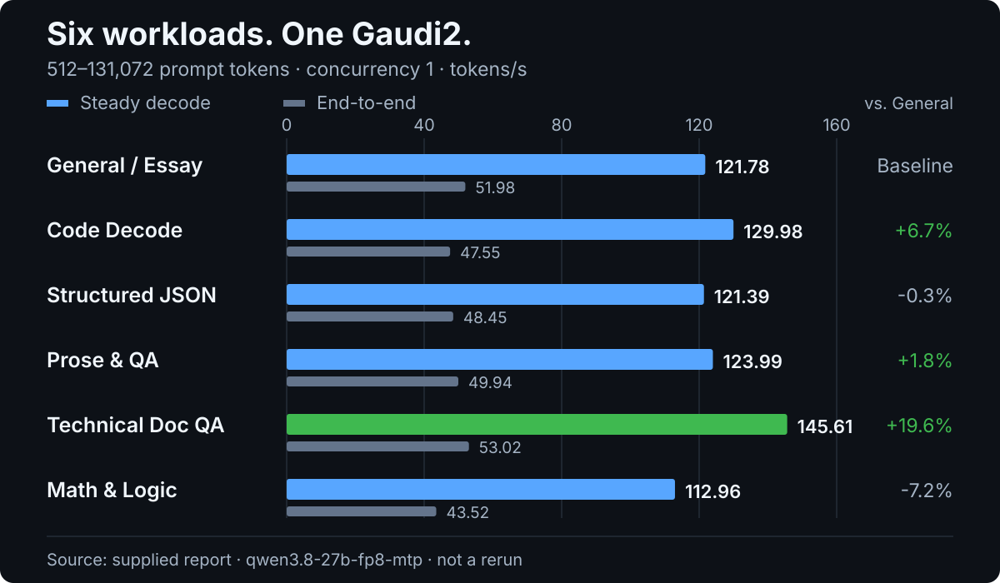
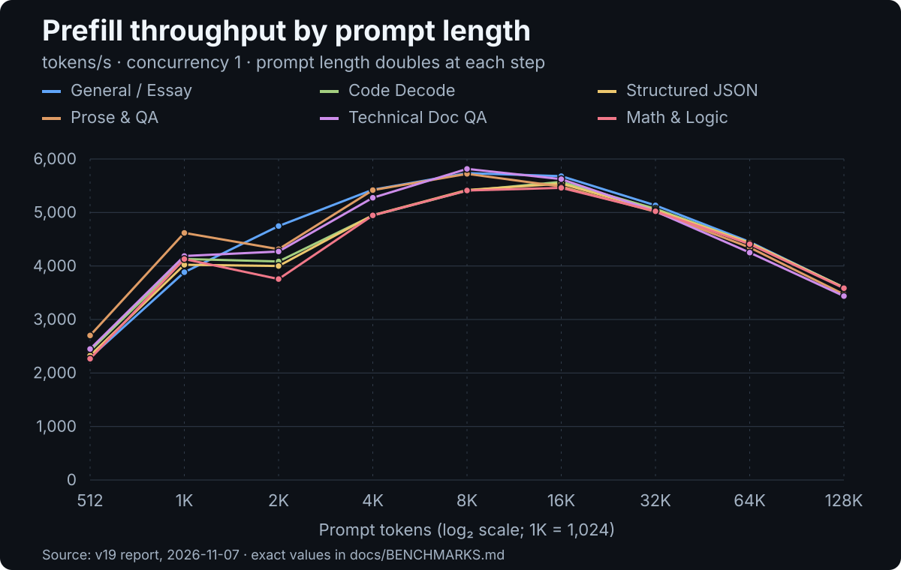
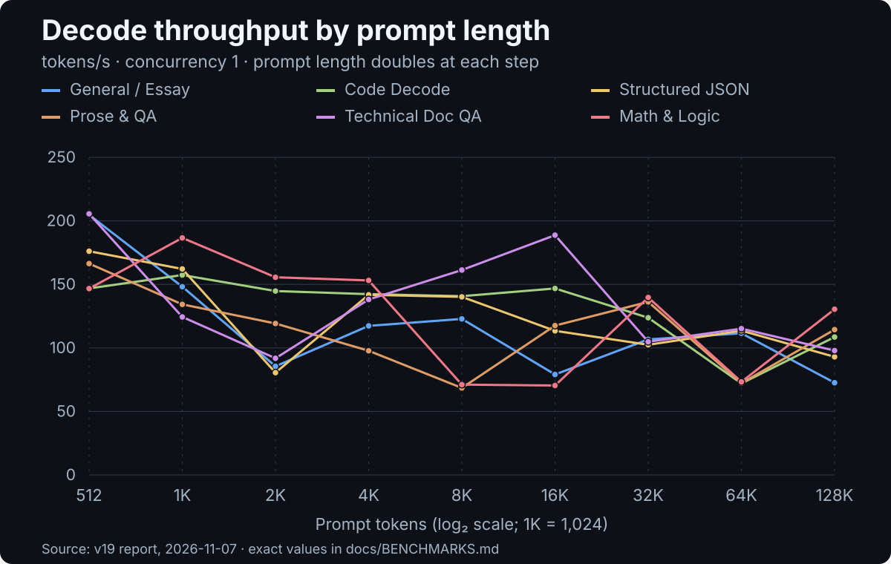

# Six-workload benchmark report

[← README](../README.md#benchmarks)

This report transcribes the speed-test screenshot for `qwen3.8-27b-fp8-mtp`, run on **2026-11-07** against the v19 deployment. It preserves the displayed values and units, and provides English tables plus machine-readable data.

## Test coverage and provenance

| Field | Value |
|:---|:---|
| Model / service alias | `qwen3.8-27b-fp8-mtp` |
| Software | v19, commit `8f3d92e` (Docker image `gaudi2-single-card-vllm:v19`, default `serve.env` prefill options) |
| Interface | OpenAI-compatible API |
| Workloads | General / Essay, Code Decode, Structured JSON, Prose & QA, Technical Doc QA, Math & Logic |
| Prompt lengths (tokens) | 512; 1,024; 2,048; 4,096; 8,192; 16,384; 32,768; 65,536; 131,072 |
| Concurrency | 1; every row shows 1/1 successful requests |
| Coverage | 6/6 workloads completed; 54 displayed measurements |
| Sampling, output length, and warm-up/cache state | Not shown in the screenshot |

The documented serving configuration pairs a **Qwen3.8-27B FP8 target** with a separate **DFlash2 FP16 draft model**; target-side MTP layers are not required. The `-mtp` suffix in the recorded service alias is a name, not a checkpoint requirement. The repository targets a single Intel Gaudi2 HL-225 (96 GiB HBM), Ubuntu 24.04, Python 3.12, and SDK 1.24.1. The v19 prefill changes and their A/B measurements are in section 22 of the [optimization log](OPTIMIZATION.md).

**Evidence:** [Report image](benchmarks/source-report.png) · [Detailed data](benchmarks/workload-details.csv) · [Summary data](benchmarks/workload-summary.csv) · [Previous report](benchmarks/previous/source-report.png) ([data](benchmarks/previous/workload-details.csv))

## Workload summary

The following values come from the report's comparison table. Its “single-stream decode” column equals the steady decode column at concurrency 1, so that duplicate is omitted here. The partially clipped total-token column is not transcribed.

| Workload | Steady decode (tokens/s) | vs. General | E2E (tokens/s) | Reported TTFT P50* (ms) | Reported ITL P50* (ms) |
|:---|---:|---:|---:|---:|---:|
| General / Essay | 116.50 | Baseline | 56.51 | 7,058.4 | 28.2 |
| Code Decode | 131.45 | +12.8% | 57.28 | 7,113.0 | 28.2 |
| Structured JSON | 124.79 | +7.1% | 55.56 | 7,122.8 | 28.4 |
| Prose & QA | 114.05 | −2.1% | 51.50 | 8,196.0 | 29.0 |
| Technical Doc QA | 136.42 | +17.1% | 55.48 | 7,973.6 | 31.4 |
| Math & Logic | 125.21 | +7.5% | 57.01 | 7,155.5 | 28.0 |

**Metric note.** The screenshot labels the summary latency columns “P50.” Each displayed TTFT summary is about 3 ms below the **arithmetic mean of its nine prompt-length TTFT rows**, not their median, and the steady-decode summaries equal the means of the nine decode rows. Treat these as **reported aggregates**, not verified request-level percentiles. The E2E formula cannot be reconstructed from the image alone.



## Context-length curves

The plots below use the displayed per-row values without smoothing. Prompt lengths are equally spaced on a **log₂ axis**: each step doubles the token count.





## Observations supported by the displayed data

- **Prefill:** peak **5,814.88 tokens/s** (Technical Doc QA, 8,192 tokens); **4,944–5,815 tokens/s** from 4K to 32K in every workload; **3,437–3,598 tokens/s** at 131,072 tokens, with TTFT **36.4–42.5 s**.
- **Against the previous report:** mean TTFT over the nine lengths is **14.5–15.4% lower** in every workload; 131K prefill rises from 3,015–3,159 to 3,437–3,598 tokens/s; at 512 tokens TTFT drops from 253–282 ms to 225–246 ms.
- **Decode:** workload averages range from **114.05** (Prose & QA) to **136.42 tokens/s** (Technical Doc QA). The highest single row is **205.54 tokens/s** (Technical Doc QA, 512 tokens). Rows vary between about 68 and 206 tokens/s because each prompt's output gives the draft model a different acceptance rate; the mean ITL stays at about 27–29 ms in most rows.

The screenshot alone does not establish why individual rows differ. It does not support conclusions about accuracy or run-to-run stability.

## Metric definitions and interpretation

| Metric | Interpretation in this transcription |
|:---|:---|
| Prompt tokens | Displayed input-length ladder; not independently retokenized |
| TTFT (ms) | Displayed time to first token for each prompt-length row |
| Mean ITL (ms) | Per-row column labeled average inter-token latency |
| Prefill (tokens/s) | Displayed prompt-processing throughput |
| Decode (tokens/s) | Displayed output/decoding throughput |
| Steady decode (tokens/s) | Workload-level figure reported by the comparison table |
| End-to-end / E2E (tokens/s) | Separately reported whole-request throughput; exact formula unavailable |
| vs. General | Relative change in the reported steady decode figure, rounded to one decimal |

Keep decode and E2E throughput separate. Do not infer decode throughput by taking `1000 / mean ITL`: speculative decoding and streamed chunks can produce multiple tokens per event, and the harness's definitions are unavailable. “Structured JSON” identifies a workload; the current speculative API rejects `response_format` and guided decoding. A 1/1 success status does not verify schema compliance or answer correctness.

## Complete per-prompt measurements

All 54 rows show **1/1 successful requests** at concurrency **1**. The common status is stated once here rather than repeated in every row.

<details>
<summary><strong>General / Essay — 9 prompt lengths</strong></summary>

| Prompt tokens | TTFT (ms) | Mean ITL (ms) | Prefill (tokens/s) | Decode (tokens/s) |
|---:|---:|---:|---:|---:|
| 512 | 226.03 | 27.16 | 2,291.79 | 204.71 |
| 1,024 | 266.57 | 26.98 | 3,883.71 | 148.17 |
| 2,048 | 434.43 | 26.72 | 4,746.65 | 85.52 |
| 4,096 | 757.86 | 27.26 | 5,426.44 | 117.34 |
| 8,192 | 1,431.22 | 27.41 | 5,736.13 | 122.83 |
| 16,384 | 2,888.09 | 27.90 | 5,679.09 | 79.08 |
| 32,768 | 6,387.42 | 29.25 | 5,132.60 | 106.70 |
| 65,536 | 14,729.48 | 29.41 | 4,450.27 | 111.52 |
| 131,072 | 36,432.14 | 32.05 | 3,598.02 | 72.59 |

</details>

<details>
<summary><strong>Code Decode — 9 prompt lengths</strong></summary>

| Prompt tokens | TTFT (ms) | Mean ITL (ms) | Prefill (tokens/s) | Decode (tokens/s) |
|---:|---:|---:|---:|---:|
| 512 | 231.52 | 27.23 | 2,415.69 | 146.81 |
| 1,024 | 260.72 | 27.10 | 4,130.87 | 157.35 |
| 2,048 | 514.46 | 26.78 | 4,084.69 | 144.75 |
| 4,096 | 839.85 | 27.24 | 4,944.05 | 142.30 |
| 8,192 | 1,525.35 | 27.55 | 5,408.56 | 140.71 |
| 16,384 | 2,950.94 | 28.11 | 5,571.96 | 146.79 |
| 32,768 | 6,474.66 | 28.72 | 5,069.73 | 123.74 |
| 65,536 | 14,798.90 | 29.61 | 4,432.14 | 72.03 |
| 131,072 | 36,447.94 | 31.85 | 3,597.58 | 108.55 |

</details>

<details>
<summary><strong>Structured JSON — 9 prompt lengths</strong></summary>

| Prompt tokens | TTFT (ms) | Mean ITL (ms) | Prefill (tokens/s) | Decode (tokens/s) |
|---:|---:|---:|---:|---:|
| 512 | 240.83 | 27.94 | 2,326.14 | 176.09 |
| 1,024 | 267.76 | 28.18 | 4,023.11 | 162.13 |
| 2,048 | 525.39 | 26.94 | 3,999.95 | 80.52 |
| 4,096 | 838.91 | 27.35 | 4,950.07 | 141.76 |
| 8,192 | 1,522.01 | 27.66 | 5,420.68 | 140.17 |
| 16,384 | 2,968.29 | 28.20 | 5,539.51 | 113.44 |
| 32,768 | 6,508.87 | 28.38 | 5,043.19 | 102.45 |
| 65,536 | 14,796.06 | 28.89 | 4,433.05 | 113.56 |
| 131,072 | 36,464.09 | 32.01 | 3,596.01 | 92.96 |

</details>

<details>
<summary><strong>Prose & QA — 9 prompt lengths</strong></summary>

| Prompt tokens | TTFT (ms) | Mean ITL (ms) | Prefill (tokens/s) | Decode (tokens/s) |
|---:|---:|---:|---:|---:|
| 512 | 224.58 | 27.46 | 2,701.28 | 166.35 |
| 1,024 | 261.75 | 27.23 | 4,618.91 | 134.25 |
| 2,048 | 542.11 | 27.51 | 4,314.22 | 119.22 |
| 4,096 | 862.59 | 27.27 | 5,418.03 | 97.74 |
| 8,192 | 1,622.12 | 33.37 | 5,722.72 | 68.48 |
| 16,384 | 3,382.34 | 27.90 | 5,484.75 | 117.57 |
| 32,768 | 7,394.50 | 28.46 | 5,013.59 | 136.22 |
| 65,536 | 17,018.90 | 29.53 | 4,345.87 | 72.22 |
| 131,072 | 42,482.66 | 31.96 | 3,470.03 | 114.40 |

</details>

<details>
<summary><strong>Technical Doc QA — 9 prompt lengths</strong></summary>

| Prompt tokens | TTFT (ms) | Mean ITL (ms) | Prefill (tokens/s) | Decode (tokens/s) |
|---:|---:|---:|---:|---:|
| 512 | 245.54 | 27.05 | 2,448.59 | 205.54 |
| 1,024 | 274.46 | 39.56 | 4,186.78 | 124.37 |
| 2,048 | 529.40 | 33.18 | 4,270.62 | 91.82 |
| 4,096 | 847.75 | 28.07 | 5,275.35 | 138.12 |
| 8,192 | 1,528.68 | 27.35 | 5,814.88 | 161.29 |
| 16,384 | 3,160.64 | 28.24 | 5,623.41 | 188.73 |
| 32,768 | 7,071.49 | 29.06 | 5,021.26 | 104.83 |
| 65,536 | 16,707.09 | 29.24 | 4,250.50 | 115.16 |
| 131,072 | 41,424.91 | 40.84 | 3,437.57 | 97.88 |

</details>

<details>
<summary><strong>Math & Logic — 9 prompt lengths</strong></summary>

| Prompt tokens | TTFT (ms) | Mean ITL (ms) | Prefill (tokens/s) | Decode (tokens/s) |
|---:|---:|---:|---:|---:|
| 512 | 246.03 | 27.25 | 2,266.78 | 146.69 |
| 1,024 | 260.47 | 27.42 | 4,129.76 | 186.58 |
| 2,048 | 558.63 | 26.52 | 3,755.79 | 155.59 |
| 4,096 | 839.28 | 26.96 | 4,945.88 | 153.10 |
| 8,192 | 1,524.38 | 27.27 | 5,411.16 | 71.11 |
| 16,384 | 3,010.57 | 27.96 | 5,461.07 | 70.40 |
| 32,768 | 6,534.43 | 28.62 | 5,022.99 | 139.69 |
| 65,536 | 14,878.72 | 29.60 | 4,408.29 | 73.26 |
| 131,072 | 36,573.94 | 30.65 | 3,585.13 | 130.43 |

</details>

## Updating the visuals

The CSV files are the editable source for the workload charts. After updating them, regenerate the static SVGs with Python's standard library:

```bash
python docs/assets/make_workload_charts.py
```

Keep the source image or equivalent raw benchmark evidence alongside any future data updates, and record the checkpoint, draft model, software revision, sampling, output length, warm-up/cache state, and aggregation definitions when they become available.
